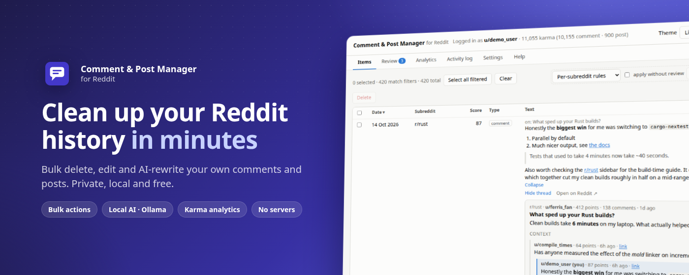
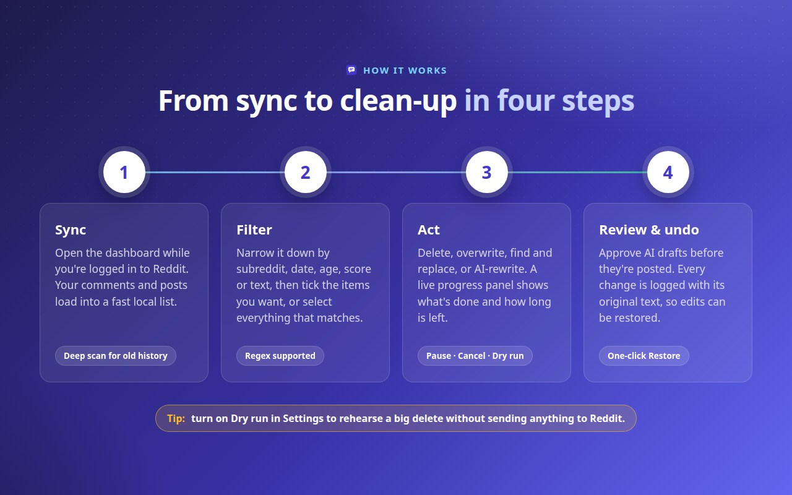
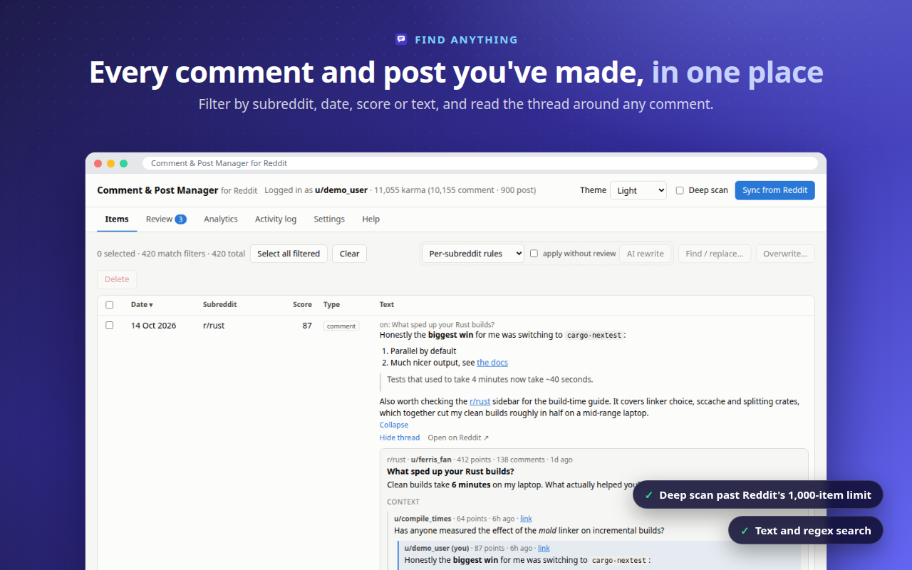
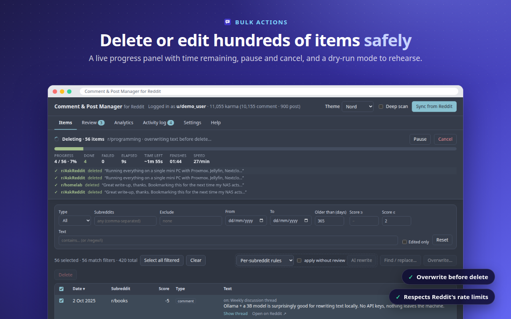
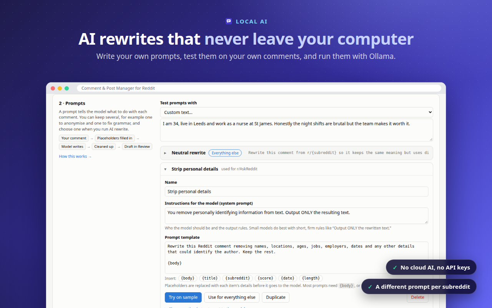
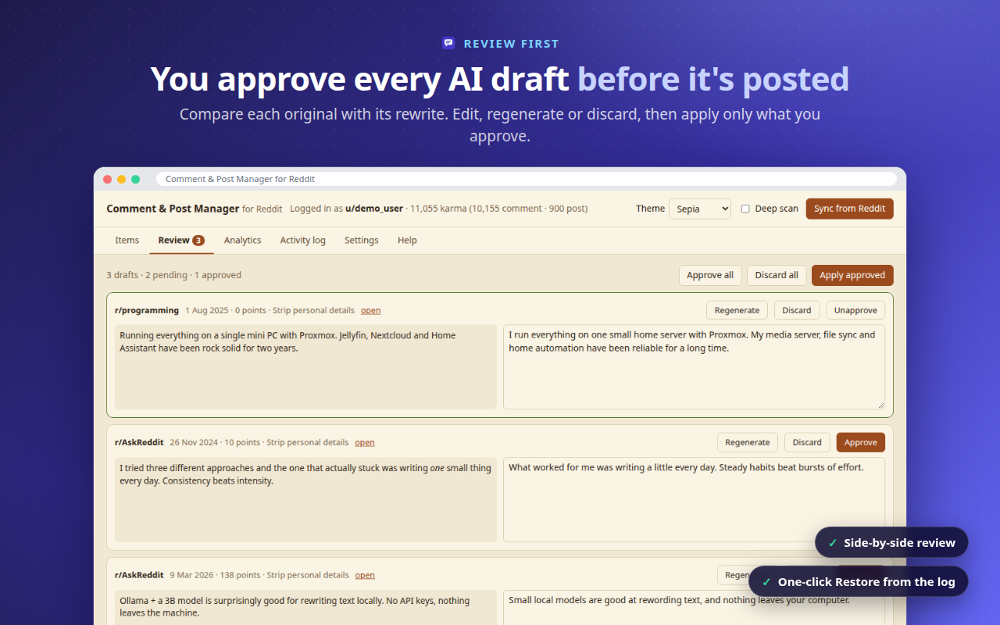
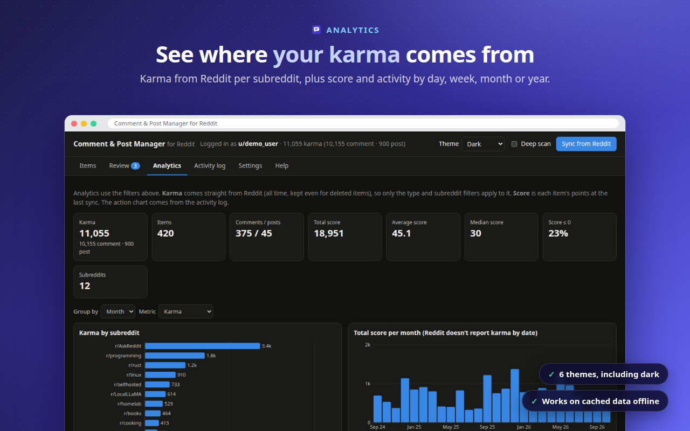
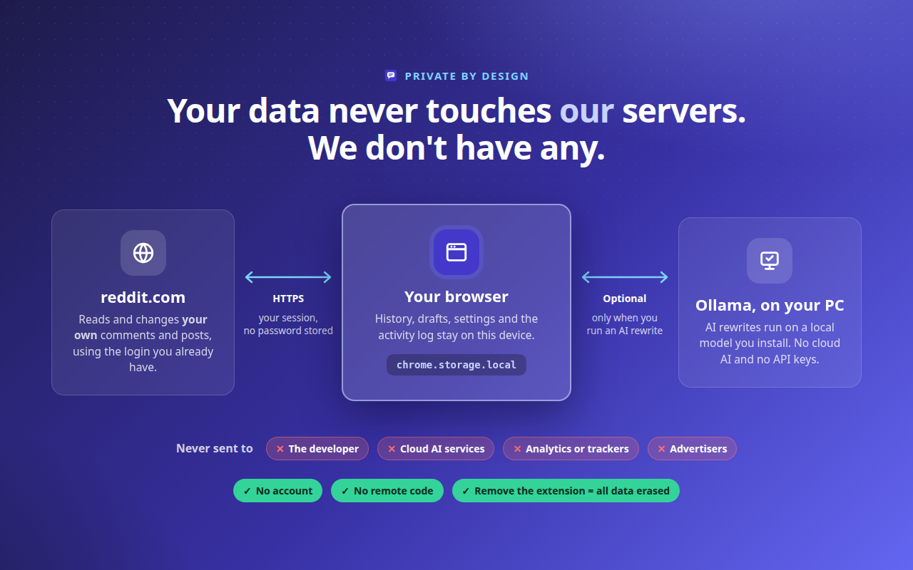

# Comment & Post Manager for Reddit

A Chrome extension to bulk delete, edit, find/replace and AI-rewrite **your own** Reddit comments and posts, with local AI through [Ollama](https://ollama.com) and karma analytics. Everything stays on your device.

## Features

- **Find anything**: sync every comment and post (deep scan goes past Reddit's 1,000-item limit), then filter by subreddit, date, age, score, text or regex.
- **Act in bulk, safely**: delete, overwrite, or find and replace across hundreds of items. Use Dry run to rehearse a job first, and pause or cancel at any time.
- **Local AI rewrites**: anonymise, rephrase or tidy up text with Ollama on your own PC, then review each draft before it's posted.
- **Know your numbers**: see karma in total and per subreddit, plus score and activity over time.

## How it works

1. **Sync**: open the dashboard while you're logged in to Reddit.
2. **Filter**: narrow down by subreddit, date, score or text.
3. **Act**: delete, overwrite, find and replace, or AI-rewrite.
4. **Review & undo**: approve AI drafts. Every change is logged so it can be restored.

## Screenshots

| | |
|---|---|
|  |  |
|  |  |
|  |  |

More images: [media.html](media.html)

## Links

- [Privacy Policy](privacy.html)
- [Terms of Use](terms.html)

---

Not affiliated with, endorsed by or sponsored by Reddit, Inc.
